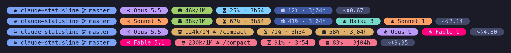

# claude-statusline

[](https://github.com/alexandrebouthinon/claude-statusline/actions/workflows/ci.yml)

A Powerline-style status line for [Claude Code](https://claude.com/claude-code), written in Go.
It starts in about a millisecond, uses no `jq` and makes no API calls, so it can refresh every few seconds.



## What it shows

| Pill | Content |
|------|---------|
| Location | Directory and git branch, read from `.git/HEAD` without starting `git` |
| Model | Active model, colored by family |
| Context | Tokens used out of the window size. Turns orange at 100k with a `/compact` reminder, and red at 200k |
| 5h limit | Share of the 5-hour quota used, and time left before it resets |
| Weekly limit | Share of the 7-day quota used, and time left before it resets |
| Agents | Subagents running right now, counted per model family. Each family keeps its model color |
| Cost | Session cost, prefixed with `~` because it is an API-equivalent estimate, not an invoice |

Model colors (Tokyo Night): **Haiku** teal · **Sonnet** orange · **Opus** purple · **Fable** pink.

## Install

Requires Go and a [Nerd Font](https://www.nerdfonts.com/) in your terminal (MesloLGS Nerd Font Mono works well).

```sh
git clone https://github.com/alexandrebouthinon/claude-statusline
cd claude-statusline
make install   # → ~/.local/bin/claude-statusline
```

Then add this to `~/.claude/settings.json`:

```json
{
  "statusLine": {
    "type": "command",
    "command": "~/.local/bin/claude-statusline",
    "refreshInterval": 5
  },
  "hooks": {
    "SubagentStart": [{ "hooks": [{ "type": "command", "command": "~/.local/bin/claude-statusline --hook", "timeout": 5 }] }],
    "SubagentStop":  [{ "hooks": [{ "type": "command", "command": "~/.local/bin/claude-statusline --hook", "timeout": 5 }] }]
  }
}
```

The two hooks are only needed for the agents pill, because Claude Code does not pass running subagents to the status line.
Each hook drops or removes a marker under `$XDG_RUNTIME_DIR/claude-statusline/<session>/`.
The status line reads each agent's model from its transcript metadata.

> **VS Code:** if Claude Code's own symbols (⏺ ⎿ ⏵) go missing after you switch to a Nerd Font, add fallbacks to the terminal font list:
> `"terminal.integrated.fontFamily": "'MesloLGS Nerd Font Mono', 'Adwaita Mono', 'Noto Sans Symbols 2', monospace"`

## Development

```sh
make test         # unit tests
make demo         # print the showcase above in your terminal
make screenshot   # regenerate docs/demo.png (needs chromium + ImageMagick)
make preview      # render ~/.claude/statusline-sample.json
```

Other palettes (p10k, Catppuccin Mocha, Nord, Gruvbox) live in `style.go`. Change `theme` to switch.
